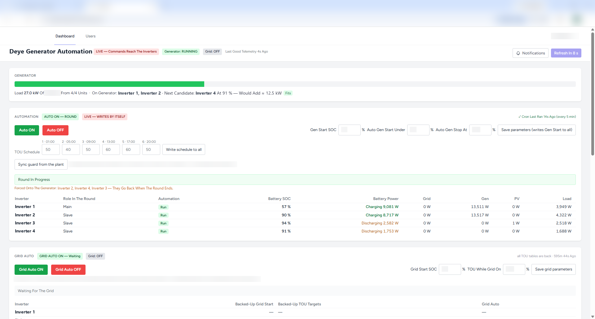
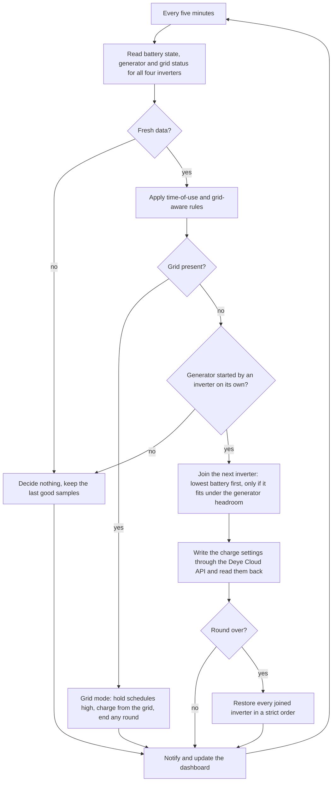
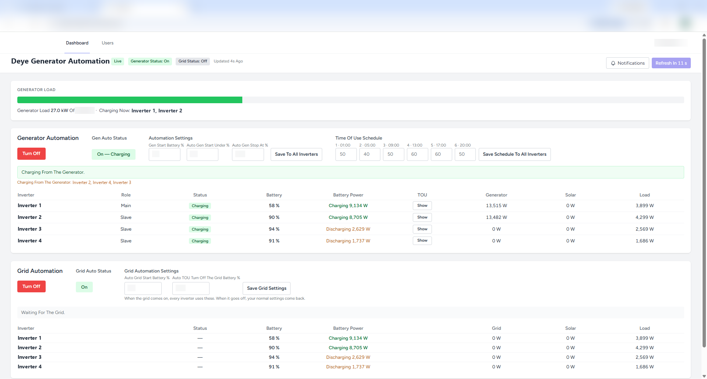
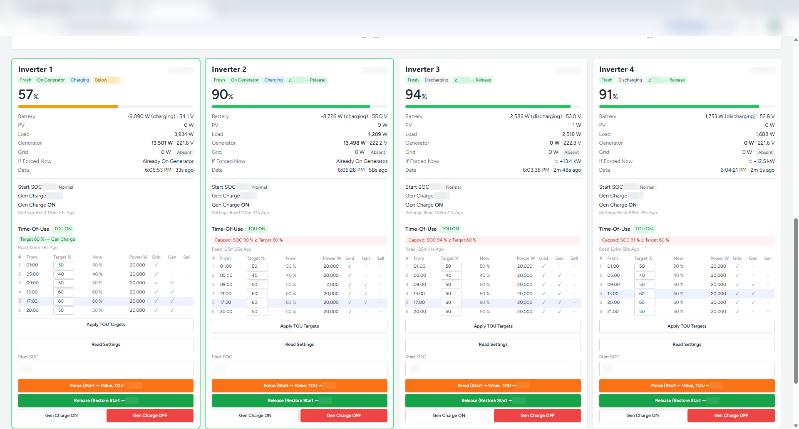
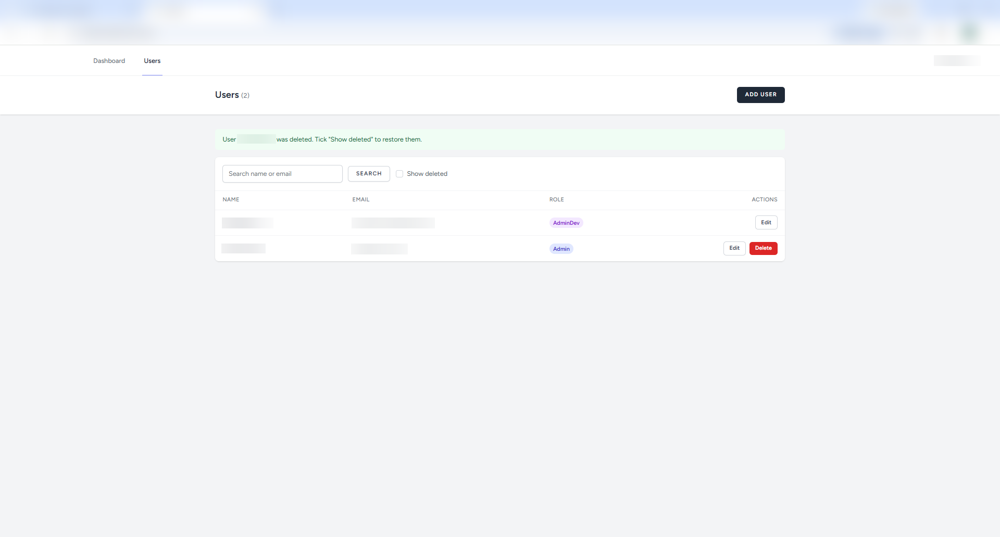

# Deye Generator Automation

One backup generator, four Deye hybrid inverters, and a problem: each inverter decided on its own when it wanted the generator, so somebody had to keep switching the generator between them by hand, and it ran 8 to 12 hours a day. This service sits on the Deye Cloud OpenAPI and shares the generator across the fleet. Every five minutes a control loop reads all four inverters, waits for a natural generator start, then brings every inverter that needs charge onto the same generator run, lowest battery first, as many as fit under the generator's headroom, budgeting each inverter at its own generator-input cap of about 13.5 kW. A time-of-use schedule shapes when batteries charge, a grid-aware mode hands charging over to the grid whenever it is present, a push notification reports every generator and grid event, and a live dashboard shows each round as it happens. Since go-live the generator runs 6 to 8 hours a week instead of 8 to 12 hours a day, about 85 percent less runtime, with fuel consumption falling in step. The system runs at a client's installation and the source is private.

## How it works

### One round, step by step

A round begins only when an inverter starts the generator by itself: its battery has fallen to its own start level, and the loop sees it drawing generator power on a fresh sample. That inverter is the main unit of the round and is never written to. In the same cycle the loop reads the settings and the time-of-use table of every other inverter whose battery is below the join level, takes a snapshot of what it finds, writes the snapshot to disk, and only then raises that inverter's schedule target and its generator-start level, in that order, so the inverter calls for the generator and can actually charge from it. Each candidate is checked against the generator's headroom before it joins, counting every inverter already in the round at its own generator-input cap, so the worst case stays under the limit. With four inverters that all fit, the whole fleet charges on one generator run.

While the round runs the loop keeps reading. If the measured generator load ever climbs above the shed limit, the inverter with the fullest battery is released. The round ends when the main unit reaches the target of its own active schedule slot, when the generator is seen off on consecutive fresh samples, when the main unit stops drawing, when the round has run too long, or when the main unit's data goes stale. The end sequence then runs on every joined inverter: generator charging off, wait until the generator is seen off, start level back to normal, schedule targets back from the snapshot, generator charging on again. Start level before re-arming, otherwise the inverter would call the generator straight back. Every step is verified by reading the inverter back, and a final read-back of every touched inverter is required before the round is declared finished.

### When the grid returns mid-round

Grid presence is judged from fresh samples, exactly as the generator is. As soon as the grid is confirmed, the grid-aware mode places a hold on the schedules: no new round may start and a running round must end. The round ends through its normal end sequence, so every joined inverter is put back before anything else happens. Only once the round reports everything restored does the grid mode take over: it backs up each inverter's six schedule targets and its grid-charge start level to its own state file, then holds the targets high and raises the grid-charge start level so the batteries charge from the grid instead of the generator. A "Grid On" push notification goes out at the moment the grid was confirmed. When the grid goes away again the backups are written back, demand first and cap second, and generator rounds may resume.

## Design decisions

**Cloud API rather than local Modbus.** Everything goes through the Deye Cloud OpenAPI: telemetry, settings reads and the writes themselves, including raw Modbus register frames that the cloud forwards to the inverter and whose replies come back as order results. That costs latency, because the cloud refreshes telemetry only about every five minutes and every write is an asynchronous order that has to be polled to completion, and it makes the whole scheme depend on Deye's servers being up. In exchange nothing new had to be installed at the site, the inverters' own loggers do the talking, and the service can run anywhere with an outbound connection. An earlier local Modbus RTU project of mine informed this one: the habit of reading back every write, the fingerprint check that proves a register block is the one that was verified before anything is written, and the plausibility window on every value come from that work. An earlier Python prototype of the supervisor, run against the same inverters, settled the control rules before this service was built.

**One generator run for the whole fleet, not one inverter per run.** The simple alternative is to let each inverter call the generator when its own battery is low and serve them one at a time. Four inverters then mean up to four generator starts a day, each running at a fraction of the generator's capacity. Instead, a round starts only when an inverter starts the generator by itself, and in the same cycle every other inverter below the join level is brought in, lowest battery first, as many as fit. The trigger inverter is never touched, so a round can never adopt a forced inverter as normal. Most of the runtime saving comes from here: one run with the generator well loaded replaces several lightly loaded ones.

**Respecting the generator limit.** The loop never uses a measured draw as a ceiling, because an inverter's draw can rise at any moment. It budgets each inverter at the generator-input cap the inverter itself enforces, read from the device when the round starts, with about 13.5 kW as the fallback, and only joins an inverter when the worst case of everyone in the round at their cap plus the newcomer stays under the generator's add limit. A separate, higher shed limit releases the fullest inverter if the measured load ever exceeds it, and a second shed needs a newer sample first, so one stale reading cannot empty the round.

**Time-of-use scheduling.** Each inverter keeps a six-slot schedule, and the target of the active slot is a hard cap on generator charging: an inverter at or above it will not charge from the generator, and will not call for it either. The operator saves six targets once on the dashboard and writes them to every inverter. A round raises only the current and the next slot on the inverters it joins, and puts exactly those back afterwards. A separate periodic check reads every inverter, compares it with the saved start level and schedule, writes back anything that was changed on the inverter's own screen or in the Deye app, and reports what it corrected on the dashboard. The schedule cannot be switched off remotely on these inverters, so the slot targets do all the work.

**Grid-aware mode.** When the grid is present it should carry the charging, not the generator. The grid mode confirms grid presence on fresh samples, waits for any running round to finish and restore, and only then backs up every inverter's six targets and grid-charge start level before writing, holds the targets high and raises the grid-charge start level. While it holds the schedules no generator round can start. When the grid goes, the backups go back. An inverter forced by hand from the dashboard is left alone, and a hold whose write came back unconfirmed is re-checked every cycle and re-sent only after a fresh read shows the schedule is not where it should be.

**Failure handling, and what the loop does when the API is unreachable.** Reads are retried with exponential backoff on connection errors, rate limiting and server errors; writes are sent exactly once at the transport level. The access token is cached and refreshed before it expires; a refusal on a young token is treated as a permission problem rather than expiry, with a cooldown, so a bad credential cannot hammer the token endpoint. Samples older than a staleness window are ignored, and a cycle with no fresh telemetry decides nothing. When the API cannot be reached at all, the cycle keeps the last good samples, logs the failure and makes no new decision; if the main unit's data stays stale the round ends and the end sequence keeps retrying every cycle until every inverter is confirmed back. A write whose outcome is unknown, because of a timeout, a server error or an unreadable reply, is never re-sent blindly: it is flagged, the round enters a fault state, every touched inverter is restored, and the automation holds for a while before resuming by itself or at once when the operator clears the fault. Under cron, every cycle is a fresh process, so the age of the state file tells a stopped scheduler from a live round, and a stale file triggers a restore rather than a continuation. The dashboard shows when nothing has run a cycle recently, so a dead loop is never mistaken for a quiet one. A fail-safe dry-run switch keeps every write logged but unsent unless it is explicitly turned off.

**Writes that are safe to repeat.** Every register write reads the current value first and skips the write when the value is already in place; every schedule write carries all six slots, so a late duplicate of an earlier order sets the same values. The intent of a write is on disk before the order is sent and is updated after the read-back confirms it, and an order whose fate is unknown is recorded and must settle before another write goes to that inverter. Because of this, a retried cycle, a restore after a crash mid-write, a daemon restart and a resend after an unconfirmed grid hold all converge on the same state instead of applying a change twice.

## Results

| Measure | Before | After | How it was measured |
|---|---|---|---|
| Generator runtime | 8 to 12 hours a day | 6 to 8 hours a week | Observed by the client over the six weeks after go-live |
| Runtime reduction | | about 85 percent | Derived from the two figures above; the full range is 86 to 93 percent and the lower bound is quoted |
| Fuel consumption | | falls in step with runtime | Not metered separately |
| Inverters sharing one generator | | 4 | Configuration |
| Control cycle | | every 5 minutes | Matches the cloud telemetry refresh |
| Automated tests | | 350+ Pest tests | Count of test cases in the private repository, including a simulated-plant round lifecycle |

## Screenshots

The full dashboard during a live round: the main inverter started the generator, three others joined, and the generator bar shows the load against its limits.

The operator view of the same round in plain language, with the automation settings, the six-slot schedule and the grid-aware mode.

One card per inverter: live figures, the settings last read from the device, its time-of-use table with the active slot highlighted, and the manual force, release and charge controls.

The admin portal: accounts with user, admin and developer roles. Registration is closed.

## Stack

- **Control service:** PHP 8.3+, Laravel 13, Artisan console commands for the cycle runner, the daemon variant, the settings check and the operator tools.
- **Device integration:** Deye Cloud OpenAPI (token, latest telemetry, order-based control with asynchronous order polling, raw Modbus register frames through custom control, time-of-use update, charge-mode control); Modbus RTU frame encoding and CRC-16 in PHP.
- **Scheduling:** cron every five minutes plus a periodic settings check on shared hosting; a long-running daemon with signal trapping as the Docker alternative.
- **State and storage:** JSON state files per concern, a CSV cycle log, MySQL 8 for accounts and push subscriptions, Laravel cache for the cross-process device lock, the API token, the telemetry cache and the heartbeat (file store in production, Redis in Docker).
- **Dashboard:** Blade templates, Tailwind CSS 3, Vite 8, a vanilla JavaScript polling client, two role-based views, installable as a PWA.
- **Authentication:** Jetstream 5 on the Livewire 3 stack, Fortify (login, password reset, two-factor), WebAuthn passkeys, Sanctum; closed registration with an admin portal.
- **Notifications:** Web Push with VAPID keys and a service worker; a log-based alert channel with optional Telegram or webhook delivery.
- **Quality:** Pest 4 with 350+ tests, Laravel Pint.
- **Deployment:** shared Linux hosting with cron in production; Docker Compose with nginx, php-fpm, a dedicated supervisor container, Redis 7 and MySQL 8 as the VPS variant; fail-safe dry-run switch.

## Source and contact

The source is private because the system runs at a client's installation. If you are interested in the code or in a similar setup for your own inverters, contact me on LinkedIn (https://www.linkedin.com/in/charbelhajjmoussa7) or at charbelhajjmoussa7@gmail.com.

## Safety note

The system sends control commands to real electrical equipment. Generator and inverter limits must be verified for each installation before anything like this is switched on, and every write path should be rehearsed in dry-run mode first.

## Author and licence

Charbel P. Hajj Moussa. GitHub: CHM2023. LinkedIn: https://www.linkedin.com/in/charbelhajjmoussa7

Copyright (c) 2026 Charbel P. Hajj Moussa. All rights reserved. This repository is published for portfolio and review purposes only; see LICENSE.
